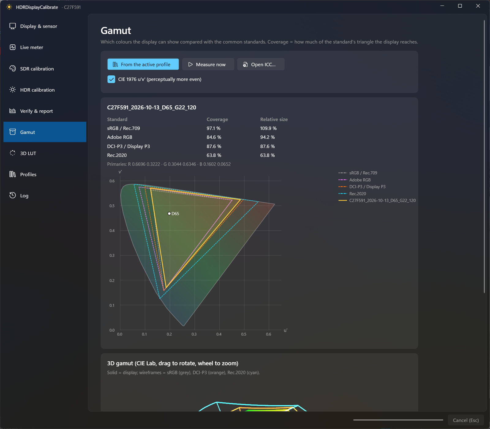
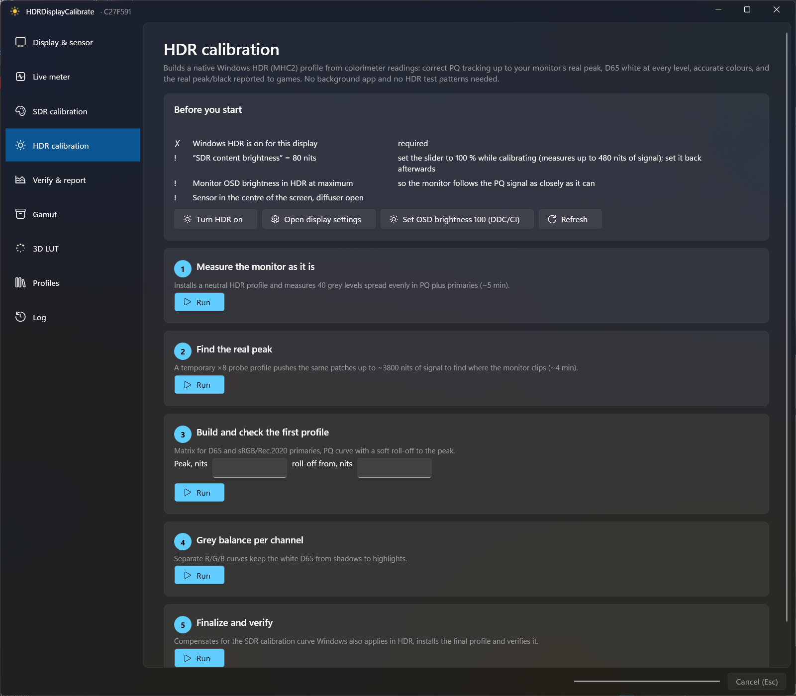
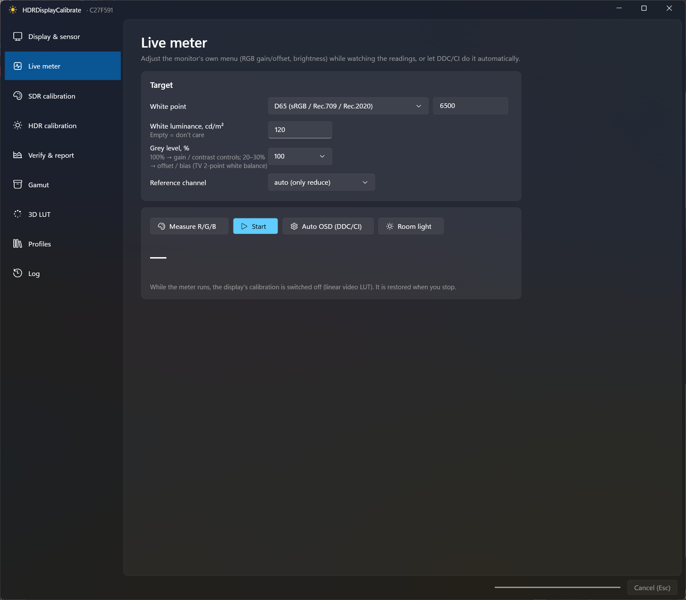
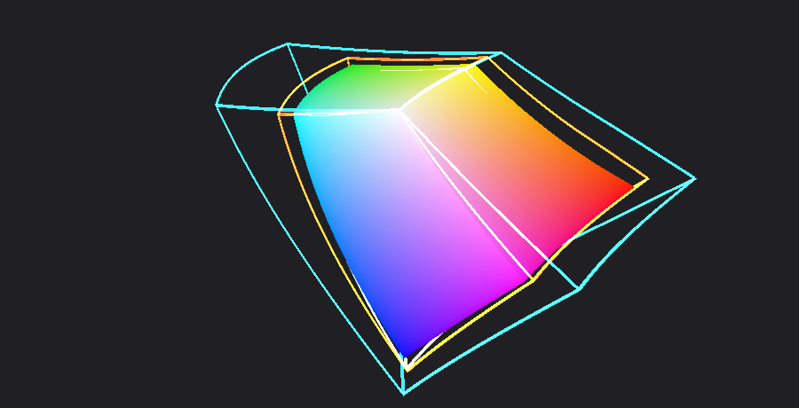
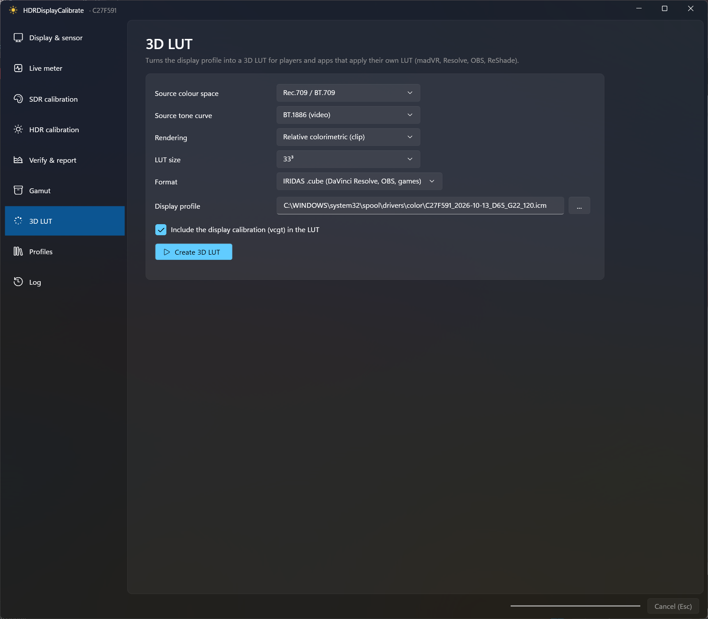

# HDRDisplayCalibrate

**SDR and HDR display calibration for Windows with an ordinary colorimeter.**
A DisplayCAL-style app (C#, .NET 10, WPF Fluent) that also calibrates **Windows HDR**. It measures the screen and writes a
native **MHC2 (advanced colour) profile**: correct PQ tracking up to the monitor's real peak, D65 white at every level,
accurate primaries, and the real peak/black reported to games. No background "filter" app, no HDR test patterns:
Windows itself applies the result.

*Українською — нижче.*



> **Status: 0.1 preview.** SDR calibration, verification, gamut, 3D LUT and the live meter / auto OSD are tested with
> a ColorMunki Display on three monitors. The HDR pipeline was validated on an ASUS VG34VQL3A (PQ tracking 0.95–1.01,
> white ΔE 0.2–1.6); the in-app HDR wizard is new, so reports are welcome.

## Features

| | |
|---|---|
| **HDR calibration (MHC2)** | 5-step wizard: measure the panel as is → find the real peak with a ×8 probe profile → PQ curve with a soft roll-off → per-channel grey balance → compensation for the SDR curve Windows also applies in HDR. Produces a Windows-native MHC2 profile (3×4 matrix + per-channel 1D LUTs). |
| **SDR calibration** | ArgyllCMS dispcal + colprof: white point (D65, D50, any colour temperature, custom xy or native), luminance, gamma 2.2 / 2.4 / BT.1886 / sRGB / L\*, optional room-light adaptation, 120…2000-patch ICC profiles (XYZ LUT + matrix or matrix/shaper). Installs the profile and loads the video LUT. |
| **Live meter** | Continuous readings (~1.5 s each) on a patch in our own window while you adjust the monitor menu: cd/m², CCT, xy, ΔE to target and per-channel R/G/B hints. |
| **Auto OSD (DDC/CI)** | Sets the monitor's own RGB gains and brightness toward the target white and luminance (typically ~15 s). |
| **Room light** | Measure the room with the diffuser before calibrating; suggests a white level and can adapt the tone curve. |
| **Verify & report** | 37 / 63 / 223-patch charts: white, black, contrast, gamma tracking, ΔE2000 of greys and colours, tables and charts. |
| **Gamut** | Coverage and relative size vs sRGB/Rec.709, Adobe RGB, DCI-P3 and Rec.2020: CIE 1931 xy or 1976 u′v′ triangles plus a rotatable 3D Lab gamut solid. |
| **3D LUT** | collink export for madVR (.3dlut), DaVinci Resolve / OBS / games (.cube), eeColor and ReShade (.png). |
| **Patches** | Our own patch window (full screen, or a borderless window you can drag and resize; placement is exact on mixed-DPI desktops) or Argyll's window. |
| **Safe by design** | Esc cancels any measurement at once and restores the calibration; the sensor is freed from background readers before measuring; no orphaned Argyll processes. |
| **Languages** | English and Ukrainian (follows Windows; `HDRDC_LANG=en` or `uk` overrides). |

<p>




</p>

## Requirements

* Windows 11, x64. For HDR: an HDR display with Windows HDR turned on.
* [ArgyllCMS](https://www.argyllcms.com/) 3.x (`C:\ArgyllCMS\bin` or `C:\Program Files\ArgyllCMS\bin` are found
  automatically; a DisplayCAL download is found too, or set the folder on the first page).
* A colorimeter supported by ArgyllCMS: X-Rite / Calibrite i1Display Pro, ColorMunki Display, Spyder, etc.

## Install

Download `HDRDisplayCalibrate.exe` from [Releases](../../releases) and run it. It is a single self-contained file:
no installer, no .NET to install. Settings live in `%APPDATA%\HDRDisplayCalibrate`; measurements and profiles in
`Documents\HDRDisplayCalibrate`.

## HDR in Windows: what to know

* An HDR (MHC2) profile takes effect only after you pick it in **Settings → Display → Color profile** while HDR is
  on. The wizard installs it and opens that page.
* Windows applies the SDR calibration curve (vcgt) on top of HDR output too. The last wizard step compensates for it.
* Keep **Auto colour management (ACM)** off in SDR, otherwise Windows uses the HDR profile in SDR as well.
* Calibrate with "SDR content brightness" at 100 % and the monitor's HDR brightness at maximum, then set the slider
  back.

## Build

```bash
dotnet publish src/HDRDisplayCalibrate.csproj -c Release -r win-x64 --self-contained true -p:PublishSingleFile=true -p:EnableCompressionInSingleFile=true -p:IncludeNativeLibrariesForSelfExtract=true -o publish
```

Developer checks: `--selftest <folder>` (re-runs the HDR pipeline and report on saved `pq_base/pq_probe8/pq_v5.ti3`
measurements), `--render3d out.png`; with a sensor on a screen: `--live-test`, `--osd-test <model> [nits]` (restores the OSD afterwards).

## Related

* [AmbientLightCalibrate](https://github.com/AndriyOrlov/AmbientLightCalibrate): tray app that keeps monitor
  brightness matched to room light with the same colorimeter.

## Support

If HDRDisplayCalibrate is useful to you, you can support its development:

* **Monobank jar:** https://send.monobank.ua/jar/7AVDtzYypi
* **Jar card number:** `4874 1000 3425 0244`

Thank you!

## License and credit

Apache License 2.0, see [LICENSE](LICENSE) and [NOTICE](NOTICE). You may use, change and redistribute it, including
commercially and in AI training or AI-generated code, as long as you keep the NOTICE and credit
**"Based on HDRDisplayCalibrate by Andrii Orlov (DeadSue)"**.

ArgyllCMS (AGPL-3.0, by Graeme W. Gill) is not bundled; it is run as external command-line tools.

---

# HDRDisplayCalibrate (українською)

**Калібрування SDR і HDR дисплеїв у Windows звичайним колориметром.** Аналог DisplayCAL, який уміє ще й **Windows HDR**:
програма міряє екран і створює рідний для Windows **MHC2-профіль** — точний PQ до реального піку монітора, D65 на всіх
рівнях, правильні кольори й справжні пік/чорний для ігор. Без фонових «фільтрів» і тестових HDR-патернів: результат
застосовує сама Windows.

**Можливості**

* **HDR-калібрування (MHC2)** — майстер у 5 кроків: замір як є → пошук реального піку → PQ-крива з м'яким спадом →
  баланс сірого по каналах → компенсація SDR-кривої, яку Windows накладає і в HDR.
* **SDR-калібрування** — точка білого, яскравість, гамма 2.2 / 2.4 / BT.1886 / sRGB / L\*, корекція під світло кімнати,
  ICC-профілі на 120…2000 патчів.
* **Живий замір** (~1,5 с на замір) з підказками по R/G/B і **Авто-OSD** — DDC/CI сам виставляє RGB і яскравість
  монітора.
* **Перевірка і звіт** — ΔE2000, гамма, контраст, таблиці й графіки.
* **Гамут** — покриття sRGB, Adobe RGB, DCI-P3, Rec.2020 трикутниками (xy / u′v′) і 3D-тілом у Lab.
* **3D-LUT** для madVR, DaVinci Resolve / OBS / ігор (.cube), eeColor і ReShade.
* Патчі на весь екран або у вікні, яке можна перетягувати й змінювати розмір.
* **Esc** миттєво скасовує будь-який замір і повертає калібрування.

**Потрібно:** Windows 11, [ArgyllCMS](https://www.argyllcms.com/) і колориметр (i1Display Pro, ColorMunki Display, Spyder…).
Завантажте `HDRDisplayCalibrate.exe` з [Releases](../../releases) — один файл, без встановлення.

**HDR-профіль** починає діяти лише після вибору в **Параметри → Дисплей → Колірний профіль** при увімкненому HDR —
майстер встановлює профіль і відкриває цю сторінку.

Ліцензія Apache 2.0. Використовуйте, змінюйте й поширюйте (зокрема для навчання ШІ та в коді, згенерованому ШІ),
зберігаючи NOTICE і вказуючи **«Based on HDRDisplayCalibrate by Andrii Orlov (DeadSue)»**.

**Підтримати розробку:** [Банка Monobank](https://send.monobank.ua/jar/7AVDtzYypi) · картка Банки `4874 1000 3425 0244`. Дякую!
